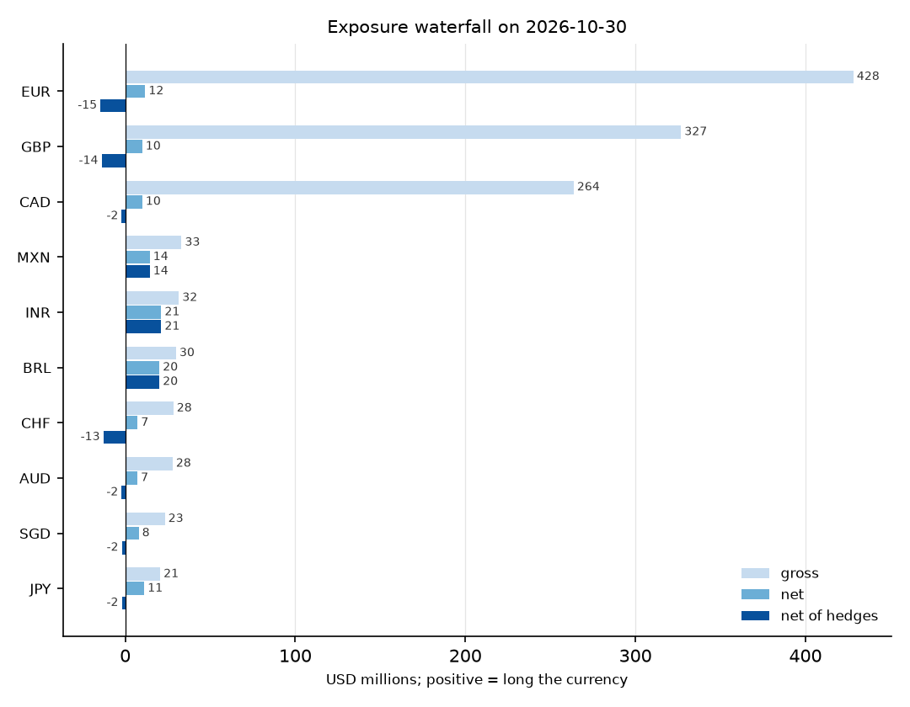
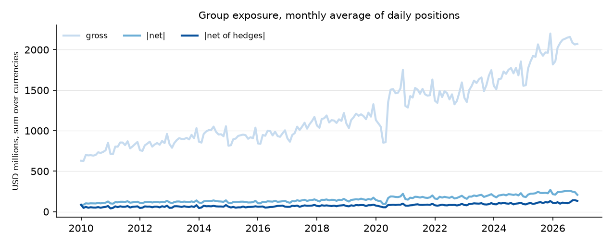
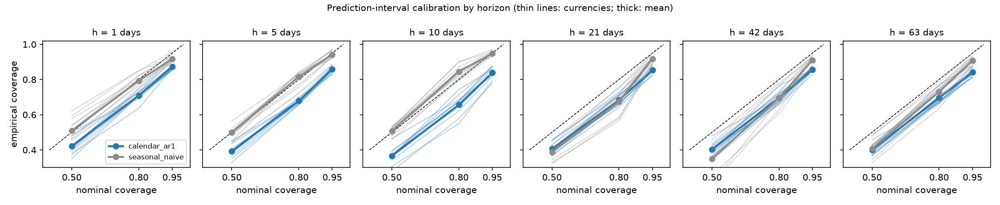
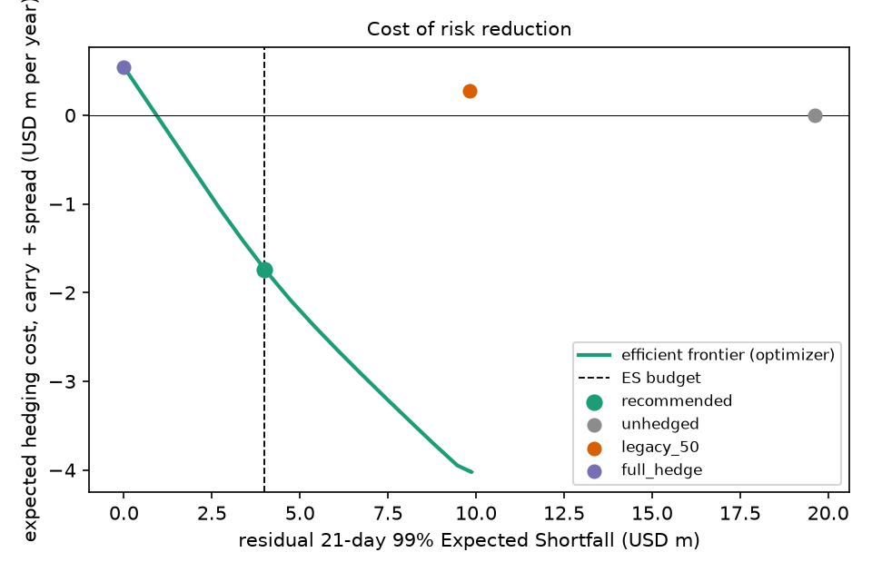
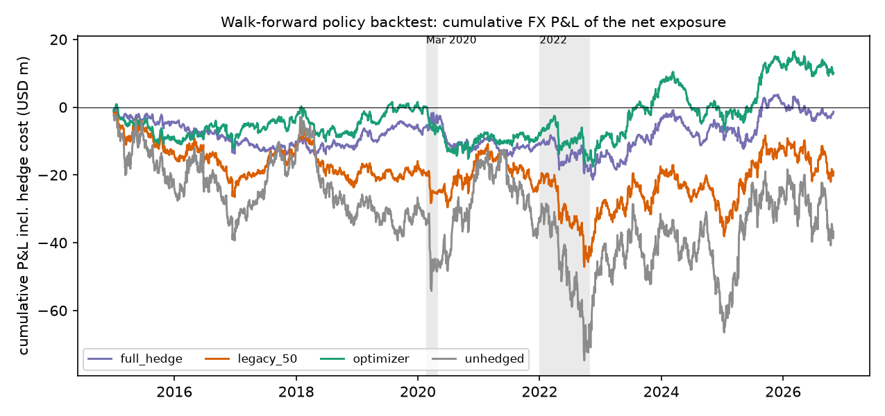
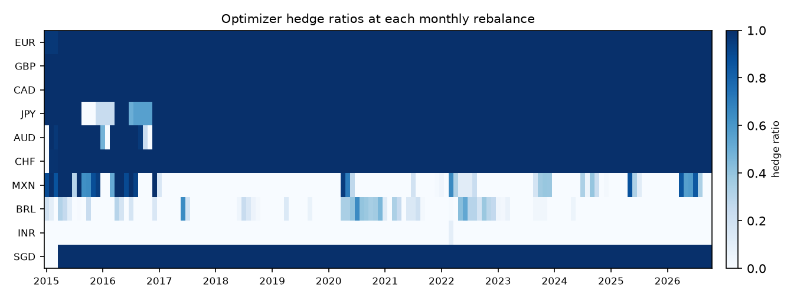
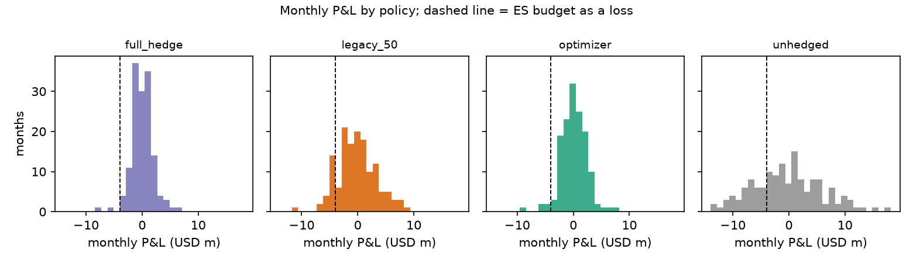

# FX hedging decision report as of 2026-10-30

## Summary

Generated 2026-11-10 13:43 UTC from market data retrieved 2026-11-06 to 2026-11-10; data quality **WARN**; ES budget USD 4m at 21 days / 99%; exposure input: calendar_ar1 median forecast, averaged over the trading days of 2026-11.

## The question and the answer

*For a fixed Expected Shortfall budget at the 21-day horizon, what hedge ratios by currency minimise expected hedging cost, and how would that policy have performed out of sample from 2015 to the present, including March 2020 and 2022?*

**With a 21-day 99% Expected Shortfall budget of USD 4m, hedge EUR, GBP, CAD, JPY, AUD, CHF, SGD in full; BRL 69%; leave MXN, INR unhedged.** That programme earns about USD 0.4m a year of carry against USD 0.3m of bid-ask spread, and cuts the ES of the forecast book from USD 12.9m to USD 4.0m. Out of sample from 2015 with a monthly rebalance (142 months), the policy's annualized P&L volatility is USD 4.6m against 10.0m unhedged and 2.3m for a full hedge; its total P&L is USD -6.6m (-23.8m unhedged, -20.8m full hedge), its maximum drawdown USD -18.5m (-36.3m unhedged). Its monthly loss exceeded its own ex-ante 99% VaR in 5 of 142 months, against about 1.4 expected if the risk model is right: too many (binomial p = 0.015). The monthly VaR covers the hedged forecast exposure only, so forecast error and intra-month exposure swings add risk it does not count. Its USD 14.2m lead over a full hedge is not statistically distinguishable from zero over 142 months (p = 0.34): it collected USD 39.8m more carry net of spread, which is known when the forwards are dealt, and lost USD 25.6m on the currency risk it left open, which is not.

| ccy | forecast exposure (USD m) | hedge ratio | forward notional (USD m) | carry % / yr (+ = costs) | spread bp | rate source |
|---|---|---|---|---|---|---|
| EUR | 42.8 | 1.00 | -42.8 | -1.39 | 0.5 | ecb:FM.D.U2.EUR.4F.KR.DFR.LEV |
| GBP | 34.7 | 1.00 | -34.7 | -0.18 | 0.7 | bis:D.GB |
| CAD | 23.7 | 1.00 | -23.7 | -1.43 | 0.7 | bis:D.CA |
| JPY | 18.0 | 1.00 | -18.0 | -2.66 | 0.6 | bis:D.JP |
| AUD | 12.4 | 1.00 | -12.4 | 0.67 | 0.9 | bis:D.AU |
| CHF | 20.4 | 1.00 | -20.4 | -3.93 | 0.8 | bis:D.CH |
| MXN | 23.5 | 0.00 | 0.0 | 2.65 | 3.0 | bis:D.MX |
| BRL | 27.5 | 0.69 | -18.9 | 9.71 | 8.0 | bis:D.BR |
| INR | 28.5 | 0.00 | 0.0 | 1.56 | 6.0 | bis:D.IN |
| SGD | 12.8 | 1.00 | -12.8 | 0.00 | 1.5 | proxy:USD:D.US |

Carry is the annualized forward discount of the currency against USD (positive: selling the currency forward costs money; negative: it earns). The optimizer spends the budget where risk reduction is expensive and hedges everything that is cheap or free to hedge: a full hedge costs USD 2.26m a year for zero residual ES, while at the USD 4m budget the cost is USD -0.02m a year (negative = the programme earns carry). Beyond a budget of about USD 10m the constraint stops binding and the policy is simply 'hedge every currency whose forward earns carry', which is the cheapest book regardless of risk. The out-of-sample evidence is in the policy section below.

## Data and quality

Market data: 8 checks on 2026-11-06 to 2026-11-10 retrievals, overall **WARN** (`reports/quality_report.md`, `reports/alerts.md`). Sources are FRED H.10 noon rates (primary), Bank of Canada and ECB crosses (reconciliation and fallback), BIS policy rates and effective exchange rates, the ECB deposit rate, and US and Canadian retail sales for the seasonality of the synthetic flows. The flows themselves are generated from `config/flows.yaml`; no real company's data is used.

| check | status | summary |
|---|---|---|
| cache_complete | PASS | all 66 registered series cached |
| schema | PASS | all cached files well-formed |
| staleness | PASS | all series fresh at retrieval; cache refreshed within the last two weeks |
| reconciliation | PASS | all 20 currency/source pairs within tolerance |
| master_completeness | PASS | 0 NULL cells across 10 currencies; 1 cells filled from BoC/ECB |
| calendar | PASS | no gaps longer than 6 calendar days |
| return_outliers | WARN | 33 daily moves beyond 6 EWMA sigma (review, not necessarily errors) |
| rates_range | PASS | all 11 rate series within [-2.0, 40.0] percent |

## Exposure waterfall

Net open exposure by currency on 2026-10-30, USD millions. *Gross* is the sum of the absolute components (receivables in flight, cash balances, merchant payables, intercompany loans) across the four entities; *net* nets them within a currency across entities; *net of hedges* adds the forwards in force on that date (the optimizer's positions where the policy has dealt, else the legacy 50% placeholder). Netting takes the group from USD 1,213m gross to 121m of absolute net exposure, and hedges to 105m. The largest net position is INR at USD 21.2m. A negative net-of-hedges figure on a month-end is expected: exposure in the synthetic business dips on the last day of the month when fees are swept and weekly payouts land, while the forward in force was sized on the average forecast over the whole month and runs until the next rebalance (ADR-0013; the history figure plots monthly averages for that reason).

| ccy | gross | net | hedges | net of hedges |
|---|---|---|---|---|
| INR | 31.5 | 21.2 | 0.0 | 21.2 |
| BRL | 29.9 | 20.1 | 0.0 | 20.1 |
| MXN | 33.1 | 14.4 | 0.0 | 14.4 |
| EUR | 428.2 | 11.7 | -26.3 | -14.6 |
| JPY | 20.5 | 11.2 | -13.2 | -2.0 |
| CAD | 263.7 | 10.0 | -12.1 | -2.1 |
| GBP | 326.8 | 10.0 | -23.9 | -13.9 |
| SGD | 23.3 | 7.9 | -9.9 | -2.0 |
| CHF | 28.3 | 7.3 | -20.2 | -12.9 |
| AUD | 27.8 | 7.2 | -9.3 | -2.1 |
| total (absolute values) | 1,213.1 | 121.0 | 114.9 | 105.3 |





By entity on the same date (USD m; the US parent's intercompany loans are the subsidiaries' intercompany liabilities):

| entity | ccy | receivables in flight | cash balance | merchant payable | intercompany | net |
|---|---|---|---|---|---|---|
| CA | CAD | 39.4 | 20.7 | -59.1 | -54.7 | -53.7 |
| CA | USD | 18.9 | 11.4 | -17.9 | 0.0 | 12.4 |
| EA | CHF | 8.4 | 4.8 | -7.8 | 0.0 | 5.4 |
| EA | EUR | 85.4 | 47.2 | -130.4 | -63.9 | -61.8 |
| EA | GBP | 13.5 | 7.1 | -12.1 | 0.0 | 8.4 |
| UK | CHF | 3.0 | 1.6 | -2.7 | 0.0 | 1.9 |
| UK | EUR | 15.3 | 8.2 | -13.8 | 0.0 | 9.6 |
| UK | GBP | 62.6 | 34.1 | -95.2 | -51.2 | -49.6 |
| US | AUD | 11.2 | 6.3 | -10.3 | 0.0 | 7.2 |
| US | BRL | 19.9 | 5.1 | -4.9 | 0.0 | 20.1 |
| US | CAD | 14.1 | 7.9 | -13.0 | 54.7 | 63.7 |
| US | EUR | 0.0 | 0.0 | 0.0 | 63.9 | 63.9 |
| US | GBP | 0.0 | 0.0 | 0.0 | 51.2 | 51.2 |
| US | INR | 20.5 | 5.9 | -5.2 | 0.0 | 21.2 |
| US | JPY | 10.2 | 5.7 | -4.7 | 0.0 | 11.2 |
| US | MXN | 16.6 | 7.1 | -9.3 | 0.0 | 14.4 |
| US | SGD | 10.0 | 5.6 | -7.7 | 0.0 | 7.9 |
| US | USD | 185.9 | 106.5 | -287.8 | 0.0 | 4.6 |

## Exposure forecast and its calibration

The hedge is sized on the forecast of net exposure averaged over the month the forward covers, not on today's book, because today's receivables will have settled by then. The model is a calendar-structural regression of log exposure on weekday, month-end and month-start position, month and trend, with AR(1) errors (ADR-0011). Rolling-origin evaluation over monthly origins from 2014 against a seasonal-naive baseline (the value on the same weekday four weeks earlier):

| horizon (days) | pinball loss, % of exposure | median abs. error, % | 50% interval coverage | 80% interval coverage | 95% interval coverage | skill vs naive |
|---|---|---|---|---|---|---|
| 1 | 2.8 | 9.9 | 0.42 | 0.71 | 0.87 | 0.26 |
| 5 | 1.6 | 5.6 | 0.39 | 0.68 | 0.86 | 0.50 |
| 10 | 1.6 | 5.6 | 0.37 | 0.66 | 0.84 | 0.46 |
| 21 | 2.2 | 7.6 | 0.41 | 0.68 | 0.85 | 0.64 |
| 42 | 2.4 | 8.5 | 0.40 | 0.70 | 0.86 | 0.59 |
| 63 | 2.2 | 7.7 | 0.40 | 0.70 | 0.84 | 0.62 |

At the policy horizon the model's skill against the naive is 0.64 (pinball loss reduced by 64%) and its nominal 95% interval covers 85% of outcomes. The intervals are therefore too narrow; the report states that rather than widening them after the fact, and the hedge policy uses the median, not the band. The skill is also an upper bound: the regression has the same terms (weekday, month end, month, trend, AR(1)) the synthetic flows were generated with, so it is correctly specified by construction; on a real book it would have to find that structure. The calibration figure shows coverage by horizon and quantile.



Latest 21-day-ahead forecast (currency units):

| ccy | target date | 2.5% | median | 97.5% |
|---|---|---|---|---|
| EUR | 2026-11-30 | 13,862,168 | 17,454,374 | 22,754,637 |
| GBP | 2026-11-30 | 9,950,499 | 13,076,830 | 17,090,123 |
| CAD | 2026-11-30 | 17,795,142 | 21,109,867 | 26,026,222 |
| JPY | 2026-11-30 | 2,795,640,376 | 3,061,699,306 | 3,479,497,061 |
| AUD | 2026-11-30 | 15,417,884 | 17,107,024 | 18,893,864 |
| CHF | 2026-11-30 | 11,387,209 | 12,985,878 | 14,590,083 |
| MXN | 2026-11-30 | 418,046,672 | 451,964,470 | 508,458,693 |
| BRL | 2026-11-30 | 145,492,270 | 155,805,799 | 173,445,632 |
| INR | 2026-11-30 | 2,704,656,726 | 2,844,296,885 | 3,018,982,062 |
| SGD | 2026-11-30 | 14,647,935 | 16,575,818 | 18,524,726 |

## Risk model: VaR, Expected Shortfall and the coverage verdicts

Expected Shortfall at 21 days / 99% on 2026-10-30, USD m, for every method family in the engine, on the net exposure and on the exposure net of hedges in force:

| model | net | net of hedges |
|---|---|---|
| historical simulation | 3.7 | 3.4 |
| Monte Carlo, t copula, EWMA 0.94 | 5.8 | 4.7 |
| Monte Carlo, t copula, EWMA 0.97 | 5.4 | 3.9 |
| normal, EWMA 0.94 | 6.0 | 4.9 |
| normal, EWMA 0.97 | 5.4 | 4.0 |
| normal, Ledoit-Wolf | 5.1 | 2.9 |
| normal, sample covariance | 5.1 | 2.9 |
| Student-t, EWMA 0.94 | 7.7 | 6.5 |
| Student-t, EWMA 0.97 | 7.0 | 5.4 |
| Student-t, Ledoit-Wolf | 6.6 | 3.8 |
| Student-t, sample covariance | 6.6 | 3.9 |

Which of these to believe is decided by the one-day coverage backtest on the net exposure from 2015 (Kupiec unconditional coverage, Christoffersen independence, Basel traffic light, Acerbi-Szekely Z2 for ES). A verdict of PASS needs every p-value at or above 0.05. Passing: none.

| model | confidence | exceptions | expected | back-to-back | Kupiec p | Christoffersen p | traffic light | Acerbi-Szekely Z2 p | verdict |
|---|---|---|---|---|---|---|---|---|---|
| historical simulation | 95% | 135 | 147.9 | 18 | 0.27 | 0.00 | n/a | 0.83 | FAIL |
| historical simulation | 99% | 29 | 29.6 | 5 | 0.92 | 0.00 | green | 0.55 | FAIL |
| normal, sample covariance | 95% | 127 | 147.9 | 17 | 0.07 | 0.00 | n/a | 0.61 | FAIL |
| normal, sample covariance | 99% | 41 | 29.6 | 8 | 0.05 | 0.00 | green | 0.00 | FAIL |
| normal, EWMA 0.94 | 95% | 154 | 147.9 | 16 | 0.61 | 0.01 | n/a | 0.01 | FAIL |
| normal, EWMA 0.94 | 99% | 50 | 29.6 | 4 | 0.00 | 0.01 | green | 0.00 | FAIL |
| Student-t, EWMA 0.94 | 95% | 169 | 147.9 | 18 | 0.08 | 0.01 | n/a | 0.03 | FAIL |
| Student-t, EWMA 0.94 | 99% | 32 | 29.6 | 3 | 0.66 | 0.00 | green | 0.18 | FAIL |
| Student-t, EWMA 0.97 | 95% | 164 | 147.9 | 19 | 0.18 | 0.00 | n/a | 0.10 | FAIL |
| Student-t, EWMA 0.97 | 99% | 37 | 29.6 | 3 | 0.19 | 0.01 | green | 0.10 | FAIL |
| Student-t, GARCH(1,1) volatilities | 95% | 158 | 147.9 | 17 | 0.40 | 0.01 | n/a | 0.23 | FAIL |
| Student-t, GARCH(1,1) volatilities | 99% | 29 | 29.6 | 2 | 0.92 | 0.03 | green | 0.43 | FAIL |

The model was chosen before that window opens: over 752 days of 2012-2014, scoring VaR and ES together with the FZ0 loss, the Student-t, EWMA 0.94 model scored best of the models the optimizer can use. The runner-up, the Student-t, GARCH(1,1) volatilities model, is not distinguishable from it (Diebold-Mariano p = 0.77), and scores slightly better after 2015; the choice is kept, not revisited. No model passes every test at 99% on this book. The optimizer uses the Student-t, EWMA 0.94 model, which fails on independence (Christoffersen): 32 exceptions against 29.6 expected (Kupiec p = 0.66), Christoffersen p = 0.00, Acerbi-Szekely p = 0.18. The independence failure rests on 3 exceptions that came the day after another: the model is right on average but slow to react inside a shock, so in a stressed week its ES budget is a looser bound than the table suggests. Its tail index is 4.9 on the latest window. Multi-day coverage is not tested formally because overlapping windows break the tests' independence assumption (ADR-0010); the 21-day ES is the one-day model scaled by the square-root of time under the t distribution.

## Stress

Historical replays of five episodes and four hypothetical shocks applied to the net exposure on 2026-10-30, P&L in USD m. *Propagated* means the shock is given to the named currencies and the others move by their Gaussian conditional expectation under the 1,000-day covariance, listed as the largest implied moves; otherwise only the named currencies move. Shocks are quoted against USD, so a conditional move partly expresses broad USD strength or weakness.

| scenario | kind | largest move | others propagated | largest implied moves | net | net of hedges |
|---|---|---|---|---|---|---|
| CHF floor removed, Jan 2015 | historical | CHF +18.1% | no |  | 1.0 | -2.1 |
| Brexit vote, Jun 2016 | historical | GBP -11.3% | no |  | -2.9 | 1.1 |
| Dash for dollars, Mar 2020 | historical | MXN -17.5% | no |  | -8.7 | -0.7 |
| USD surge, Aug-Sep 2022 | historical | GBP -13.3% | no |  | -6.4 | 2.2 |
| Taper tantrum, May-Aug 2013 | historical | INR -16.7% | no |  | -6.5 | -8.6 |
| USD +10% against all | hypothetical | EUR -10.0% | no |  | -11.5 | -0.6 |
| EM selloff (BRL, MXN -15%, INR -10%) | hypothetical | MXN -15.0% | no |  | -6.8 | -6.8 |
| EM selloff (BRL, MXN -15%, INR -10%) | hypothetical | MXN -15.0% | yes | AUD -10.8%, EUR -7.3%, GBP -7.2% | -11.0 | -3.6 |
| EUR -10% | hypothetical | EUR -10.0% | no |  | -1.1 | 1.4 |
| EUR -10% | hypothetical | EUR -10.0% | yes | AUD -9.4%, CHF -8.9%, GBP -8.7% | -7.1 | 2.0 |
| JPY +10% | hypothetical | JPY +10.0% | no |  | 1.2 | -0.2 |
| JPY +10% | hypothetical | JPY +10.0% | yes | CHF +4.6%, AUD +3.9%, GBP +3.6% | 3.7 | -1.4 |

## Cost of risk reduction: the frontier and the chosen point

The frontier traces the minimum expected hedging cost (carry plus spread, per year) for every ES budget from zero (full hedge) to the unhedged ES. A full hedge costs USD 2.26m a year for zero residual ES, while at the USD 4m budget the cost is USD -0.02m a year (negative = the programme earns carry). Beyond a budget of about USD 10m the constraint stops binding and the policy is simply 'hedge every currency whose forward earns carry', which is the cheapest book regardless of risk. Reference policies at today's exposures:

| policy | residual ES (USD m) | expected cost (USD m / yr, + = cost) |
|---|---|---|
| unhedged | 12.89 | 0.00 |
| legacy 50% | 6.45 | 1.13 |
| full hedge | 0.00 | 2.26 |
| optimizer | 4.00 | -0.02 |



The optimizer is a convex programme (linear cost, ES of a linear book under an elliptical distribution is a norm of an affine function of the ratios) solved with SLSQP. A 10 bp penalty on the change in notional since the previous month is added to the objective as a preference for a stable programme; it reduces month-to-month swings in the ratios without measurably changing P&L, volatility or cost (ADR-0012).

## Out-of-sample policy performance, 2015 to the present

Walk-forward backtest, monthly rebalance from 2015-01-01, one-month forwards priced by covered interest parity at each origin, hedging the median forecast averaged over the month each forward covers; P&L marked on the actual daily exposure path with forward mark-to-market, carry accrual and spread (ADR-0013). No look-ahead: covariance, tail index, rates and forecasts use data up to the origin only.

| policy | P&L vol / yr | total P&L | hedging cost / yr (+ = cost) | max drawdown | worst month | months loss > ex-ante VaR | months losing > USD 4m | share of months budget binds |
|---|---|---|---|---|---|---|---|---|
| unhedged | 10.0 | -23.8 | 0.0 | -36.3 | -7.2 | 3 | 12 | 0.00 |
| legacy 50% | 5.2 | -22.3 | 1.2 | -26.1 | -4.3 | 4 | 1 | 0.00 |
| full hedge | 2.3 | -20.8 | 2.5 | -22.5 | -2.4 | 80 | 0 | 0.00 |
| optimizer | 4.6 | -6.6 | -0.9 | -18.5 | -5.0 | 5 | 1 | 0.57 |

USD m. Hedging cost is carry plus bid-ask spread per year, positive when the hedges cost money, the same convention as the frontier above. Months losing more than the budget is a plain loss frequency, comparable across policies; the model test is the count of months beyond each policy's own ex-ante 99% VaR, about 1% of months if the model is right. A full hedge of the forecast has no ex-ante risk in the model, so every month it loses counts: its risk is all forecast error.

Mean optimizer hedge ratio over the backtest: EUR 1.00, GBP 1.00, CAD 1.00, JPY 0.94, AUD 0.97, CHF 0.99, MXN 0.19, BRL 0.08, INR 0.00, SGD 0.98.





**March 2020 and 2022.** Monthly P&L by policy in the four stress months, USD m:

| month | unhedged | legacy 50% | full hedge | optimizer | optimizer ex-ante ES |
|---|---|---|---|---|---|
| 2020-03 | -6.7 | -3.2 | 0.4 | -5.0 | 3.7 |
| 2020-04 | 0.2 | 0.2 | 0.1 | -0.1 | 4.0 |
| 2022-09 | -5.1 | -2.3 | 0.6 | -0.3 | 4.0 |
| 2022-10 | 0.5 | -0.2 | -0.8 | -0.4 | 4.0 |

The optimizer's worst of the four was 2020-03 at USD -5.0m against an ex-ante ES of 3.7m: the budget bounds the risk of the hedged *forecast* exposure, not forecast error or intra-month exposure swings, which is also why the full hedge keeps USD 2.3m of annual P&L volatility.

**By year** (total P&L, USD m):

| year | unhedged | legacy 50% | full hedge | optimizer | optimizer months losing > USD 4m |
|---|---|---|---|---|---|
| 2015 | -14.2 | -8.7 | -3.2 | -7.8 | 0 |
| 2016 | -2.7 | -3.7 | -4.8 | 0.7 | 0 |
| 2017 | 9.1 | 3.4 | -2.4 | 2.7 | 0 |
| 2018 | -8.9 | -5.2 | -1.5 | -3.6 | 0 |
| 2019 | 1.8 | 0.7 | -0.3 | 1.8 | 0 |
| 2020 | 4.1 | 2.4 | 0.6 | -3.2 | 1 |
| 2021 | -7.7 | -4.7 | -1.8 | -1.0 | 0 |
| 2022 | -5.2 | -2.3 | 0.6 | 3.6 | 0 |
| 2023 | 8.6 | 3.3 | -1.9 | 5.6 | 0 |
| 2024 | -18.5 | -9.6 | -0.6 | -7.7 | 0 |
| 2025 | 14.5 | 5.7 | -3.1 | 4.8 | 0 |
| 2026 | -4.5 | -3.5 | -2.4 | -2.4 | 0 |



## What this model does not know

* **The business is synthetic.** Volumes, settlement lags, payout cadences and the 2020 regimes are stylized and calibrated only to public retail-sales seasonality (ADR-0008). The *method* transfers to a real book; the numbers do not.
* **The ES budget covers the hedged forecast exposure only.** Forecast error and intra-month exposure variation are outside it: the model sees no risk in a full hedge of the forecast, yet that policy keeps USD 2.3m of annual P&L volatility (ADR-0013). Its monthly loss exceeded its own ex-ante 99% VaR in 5 of 142 months, against about 1.4 expected if the risk model is right: too many (binomial p = 0.015). The monthly VaR covers the hedged forecast exposure only, so forecast error and intra-month exposure swings add risk it does not count. A budget meant to bound realized monthly loss would need to be set lower, or the policy would need an intra-month adjustment rule (backlog B17).
* **Forecast intervals are too narrow.** The nominal 95% band covers 85% at the 21-day horizon (ADR-0011, backlog B16). The policy uses the median, so this affects the risk statement, not the hedge sizes. Its skill is flattered too: the model has the generator's own terms, a correct specification a real book would not hand it.
* **Carry is an expected cost under a random-walk spot.** Realized hedging cost in the backtest includes the spot move and can have either sign; the carry signal itself is not a forecast of returns (hedging primer, section 3).
* **Forwards only.** No options, no cross-currency basis, no NDF basis for BRL and INR; one-way spreads are stylized round numbers from `config/hedge.yaml` (hedging primer, section 5; backlog B3, B4, B18).
* **Forwards are priced off central-bank policy rates**, the ECB deposit rate for the euro area, so carry ignores rate changes expected within the month; one- and three-month OIS rates would be better but are not freely available. The SGD rate is a flagged USD proxy, so SGD carry is zero by construction (ADR-0015, backlog B1, B2).
* **Coverage is tested at one day.** The 21-day ES is a scaled one-day model; the overlapping-window tests at longer horizons have too little power to be decisive (ADR-0010, backlog B11).
* **One risk model inside the optimizer, and it does not pass every test.** The Student-t EWMA model was chosen on the coverage backtest over the same 2015-2026 period the policy is evaluated on, and on the current book its exceptions cluster. The engine reports every model so the choice can be revisited.
* **Fixing-time mismatches** between sources (noon New York, 14:15 CET, Bank of Canada daily average) are reconciled within tolerance, not modelled (ADR-0005).
* **Weekday calendar, no holidays**, for settlement and payouts (backlog B9).

## Reproducing this report

```bash
uv sync --all-groups
uv run fxrisk all      # fetch (cache) -> quality -> flows -> exposure -> forecast -> backtest -> hedge -> risk -> report
```

Every number above is read from the DuckDB tables the stages write (`data/fxrisk.duckdb`); `fxrisk report` recomputes nothing. Inputs: `config/flows.yaml` (the stylized business), `config/hedge.yaml` (budget, costs, policies), `data/cache/` (market data with provenance in `manifest.json`). Methods: `docs/methodology.md`; decisions: `docs/decisions/`; instrument mechanics: `docs/hedging-primer.md`. Package version 0.1.0.
