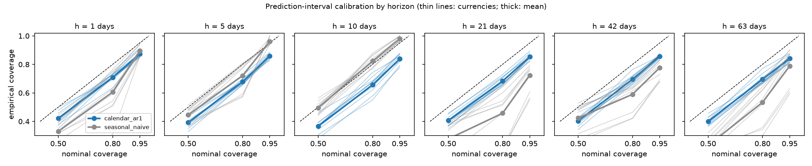
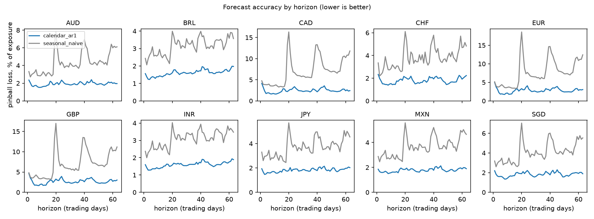
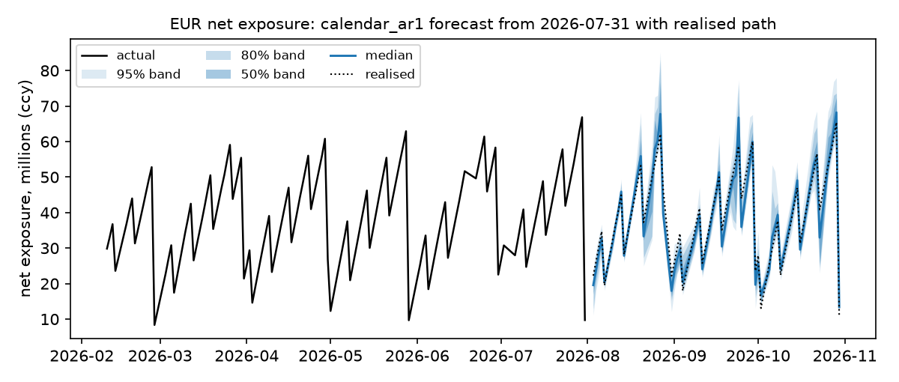

# Exposure forecast evaluation

## Setup

140 monthly origins from 2014-12-31 to 2026-07-31, horizons 1-63 trading days, training window 750 days. Pinball loss is averaged over the 2.5/10/25/50/75/90/97.5 quantiles and scaled by the mean actual. Coverage is the share of actuals inside the central 50/80/95% intervals. Skill is 1 - pinball / pinball of the seasonal naive.

## By horizon, averaged over currencies

| model | horizon (days) | pinball loss, % of exposure | median abs. error, % | 50% interval coverage | 80% interval coverage | 95% interval coverage | skill vs naive |
|---|---|---|---|---|---|---|---|
| calendar regression, AR(1) errors | 1 | 2.76 | 9.86 | 0.42 | 0.71 | 0.87 | 0.26 |
| calendar regression, AR(1) errors | 5 | 1.62 | 5.59 | 0.39 | 0.68 | 0.86 | 0.5 |
| calendar regression, AR(1) errors | 10 | 1.63 | 5.61 | 0.37 | 0.66 | 0.84 | 0.46 |
| calendar regression, AR(1) errors | 21 | 2.23 | 7.61 | 0.41 | 0.68 | 0.85 | 0.64 |
| calendar regression, AR(1) errors | 42 | 2.44 | 8.51 | 0.4 | 0.7 | 0.86 | 0.59 |
| calendar regression, AR(1) errors | 63 | 2.24 | 7.74 | 0.4 | 0.69 | 0.84 | 0.62 |
| seasonal naive | 1 | 3.55 | 10.39 | 0.51 | 0.79 | 0.92 | 0 |
| seasonal naive | 5 | 3.27 | 9.87 | 0.5 | 0.81 | 0.94 | 0 |
| seasonal naive | 10 | 3.04 | 9.24 | 0.51 | 0.84 | 0.95 | 0 |
| seasonal naive | 21 | 7.04 | 24.08 | 0.39 | 0.67 | 0.92 | 0 |
| seasonal naive | 42 | 6.64 | 23.92 | 0.35 | 0.69 | 0.91 | 0 |
| seasonal naive | 63 | 6.81 | 24.66 | 0.41 | 0.73 | 0.91 | 0 |

## At 21 days, by currency

| ccy | model | pinball loss, % of exposure | median abs. error, % | 50% interval coverage | 80% interval coverage | 95% interval coverage | skill vs naive |
|---|---|---|---|---|---|---|---|
| AUD | calendar regression, AR(1) errors | 2.07 | 7.3 | 0.43 | 0.71 | 0.86 | 0.66 |
| AUD | seasonal naive | 6.03 | 20.9 | 0.39 | 0.72 | 0.92 | 0 |
| BRL | calendar regression, AR(1) errors | 1.77 | 6.29 | 0.39 | 0.66 | 0.84 | 0.52 |
| BRL | seasonal naive | 3.72 | 13.06 | 0.41 | 0.71 | 0.95 | 0 |
| CAD | calendar regression, AR(1) errors | 2.71 | 9.11 | 0.45 | 0.73 | 0.89 | 0.77 |
| CAD | seasonal naive | 11.56 | 40.1 | 0.34 | 0.59 | 0.89 | 0 |
| CHF | calendar regression, AR(1) errors | 2 | 7 | 0.37 | 0.64 | 0.83 | 0.62 |
| CHF | seasonal naive | 5.3 | 17.45 | 0.41 | 0.7 | 0.91 | 0 |
| EUR | calendar regression, AR(1) errors | 3 | 10.03 | 0.4 | 0.66 | 0.85 | 0.77 |
| EUR | seasonal naive | 13.29 | 44.92 | 0.33 | 0.56 | 0.88 | 0 |
| GBP | calendar regression, AR(1) errors | 2.98 | 9.92 | 0.4 | 0.67 | 0.82 | 0.75 |
| GBP | seasonal naive | 12.09 | 40.79 | 0.32 | 0.58 | 0.89 | 0 |
| INR | calendar regression, AR(1) errors | 1.68 | 5.8 | 0.41 | 0.71 | 0.88 | 0.52 |
| INR | seasonal naive | 3.5 | 12.2 | 0.46 | 0.75 | 0.95 | 0 |
| JPY | calendar regression, AR(1) errors | 2.03 | 7.04 | 0.36 | 0.68 | 0.85 | 0.58 |
| JPY | seasonal naive | 4.82 | 16.7 | 0.39 | 0.68 | 0.93 | 0 |
| MXN | calendar regression, AR(1) errors | 1.94 | 6.61 | 0.4 | 0.66 | 0.85 | 0.59 |
| MXN | seasonal naive | 4.72 | 16.09 | 0.39 | 0.69 | 0.93 | 0 |
| SGD | calendar regression, AR(1) errors | 2.1 | 7.04 | 0.46 | 0.71 | 0.85 | 0.61 |
| SGD | seasonal naive | 5.37 | 18.56 | 0.43 | 0.76 | 0.92 | 0 |

## Latest 21-day-ahead forecast of net exposure (currency units), calendar model

| ccy | target date | 2.5% | median | 97.5% |
|---|---|---|---|---|
| EUR | 2026-11-30 | 13,862,168 | 17,454,374 | 22,754,637 |
| GBP | 2026-11-30 | 9,950,499 | 13,076,830 | 17,090,123 |
| CAD | 2026-11-30 | 17,795,142 | 21,109,867 | 26,026,222 |
| JPY | 2026-11-30 | 2,795,640,376 | 3,061,699,306 | 3,479,497,061 |
| AUD | 2026-11-30 | 15,417,884 | 17,107,024 | 18,893,864 |
| CHF | 2026-11-30 | 11,387,209 | 12,985,878 | 14,590,083 |
| MXN | 2026-11-30 | 418,046,672 | 451,964,470 | 508,458,693 |
| BRL | 2026-11-30 | 145,492,270 | 155,805,799 | 173,445,632 |
| INR | 2026-11-30 | 2,704,656,726 | 2,844,296,885 | 3,018,982,062 |
| SGD | 2026-11-30 | 14,647,935 | 16,575,818 | 18,524,726 |

## Figures

