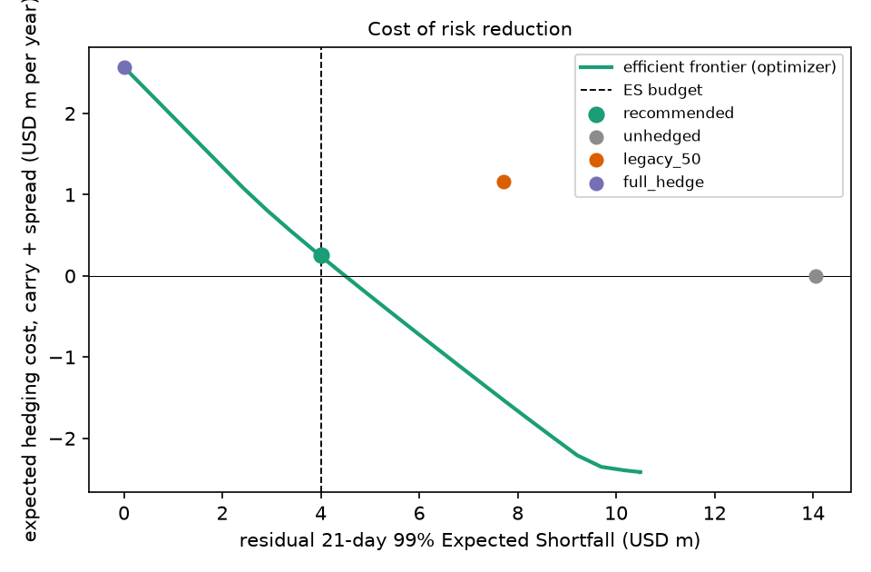

# Hedge recommendation as of 2026-11-06

## Setup

Exposure input: calendar_ar1 median forecast, averaged over the trading days of 2026-12. Risk model: Student-t with EWMA(0.94) covariance at 21 days / 99%. Forwards: 30-day tenor priced by CIP.

## Headline

| quantity | value |
|---|---|
| unhedged ES (USD m) | 14.06 |
| ES budget (USD m) | 4 |
| residual ES with recommended hedges (USD m) | 4 |
| expected carry cost per year (USD m) | -0.14 |
| spread cost per year (USD m) | 0.4 |
| tail index nu | 5.09 |
| budget binding | yes |

## Recommended hedge ratios by currency

| ccy | exposure (currency units) | exposure (USD m) | hedge ratio | forward notional (USD m) | carry (% / yr, + = cost) | spread (bp) | rate source | proxy rate |
|---|---|---|---|---|---|---|---|---|
| EUR | 44,310,980 | 49.42 | 1 | -49.42 | -1.39 | 0.5 | ecb:FM.D.U2.EUR.4F.KR.DFR.LEV | no |
| GBP | 29,893,092 | 39.97 | 1 | -39.97 | 0.07 | 0.7 | bis:D.GB | no |
| CAD | 36,473,065 | 25.86 | 1 | -25.86 | -1.43 | 0.7 | bis:D.CA | no |
| JPY | 3,111,424,101 | 19.66 | 1 | -19.66 | -2.66 | 0.6 | bis:D.JP | no |
| AUD | 19,860,738 | 13.65 | 1 | -13.65 | 0.92 | 0.9 | bis:D.AU | no |
| CHF | 19,300,018 | 23.56 | 1 | -23.56 | -3.93 | 0.8 | bis:D.CH | no |
| MXN | 500,181,816 | 26.86 | 0.39 | -10.46 | 2.4 | 3 | bis:D.MX | no |
| BRL | 168,262,710 | 30.65 | 0.66 | -20.18 | 9.71 | 8 | bis:D.BR | no |
| INR | 3,031,634,940 | 32.28 | 0 | 0 | 1.56 | 6 | bis:D.IN | no |
| SGD | 18,702,678 | 14.59 | 1 | -14.59 | 0 | 1.5 | proxy:USD:D.US | yes |

## Reference policies at today's exposures

| policy | residual ES (USD m) | expected cost (USD m / yr, + = cost) |
|---|---|---|
| unhedged | 14.06 | 0 |
| legacy 50% | 7.71 | 1.17 |
| full hedge | 0 | 2.57 |
| optimizer | 4 | 0.26 |

## Frontier (every other point)

| ES budget (USD m) | residual ES (USD m) | expected cost (USD m / yr, + = cost) | mean hedge ratio |
|---|---|---|---|
| 0 | 0 | 2.57 | 1 |
| 0.97 | 0.97 | 1.98 | 0.93 |
| 1.94 | 1.94 | 1.38 | 0.86 |
| 2.91 | 2.91 | 0.81 | 0.82 |
| 3.88 | 3.88 | 0.3 | 0.8 |
| 4.85 | 4.85 | -0.17 | 0.78 |
| 5.82 | 5.82 | -0.64 | 0.76 |
| 6.79 | 6.79 | -1.1 | 0.74 |
| 7.76 | 7.76 | -1.55 | 0.72 |
| 8.73 | 8.73 | -1.99 | 0.71 |
| 9.7 | 9.7 | -2.35 | 0.51 |
| 10.67 | 10.49 | -2.42 | 0.4 |
| 11.63 | 10.49 | -2.42 | 0.4 |
| 12.61 | 10.49 | -2.42 | 0.4 |
| 13.57 | 10.49 | -2.42 | 0.4 |

## Figure

