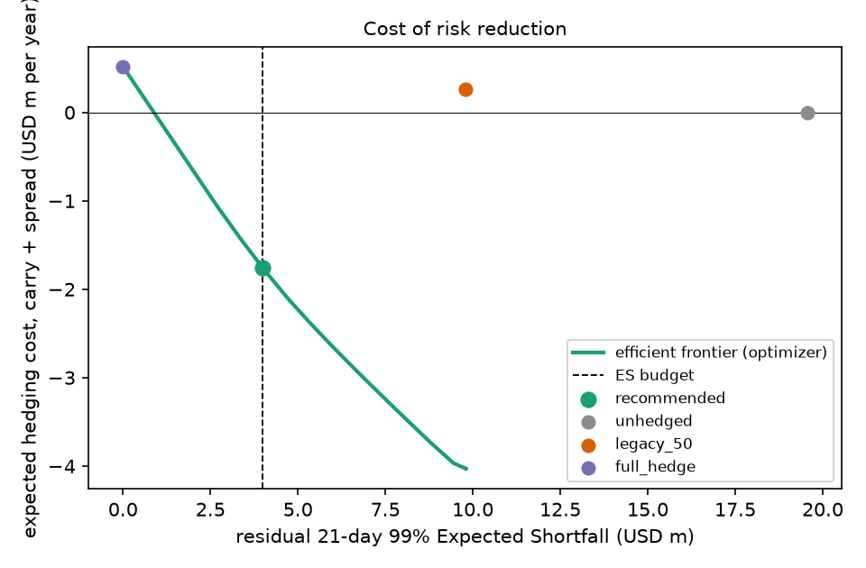

# Hedge recommendation as of 2026-10-30

## Setup

Exposure input: calendar_ar1 median forecast, 21 days ahead. Risk model: Student-t with EWMA(0.94) covariance at 21 days / 99%. Forwards: 30-day tenor priced by CIP.

## Headline

| quantity | value |
|---|---|
| unhedged ES (USD m) | 19.55 |
| ES budget (USD m) | 4 |
| residual ES with recommended hedges (USD m) | 4 |
| expected carry cost per year (USD m) | -2.23 |
| spread cost per year (USD m) | 0.47 |
| tail index nu | 4.92 |
| budget binding | yes |

## Recommended hedge ratios by currency

| index | exposure_fcy | exposure_usd_m | hedge_ratio | notional_usd_m | carry_pct_annual | spread_bp | rate_source | is_proxy |
|---|---|---|---|---|---|---|---|---|
| EUR | 113,974,414 | 127.23 | 1 | -127.23 | -1.55 | 0.5 | bis:D.XM | no |
| GBP | 69,137,160 | 92.63 | 1 | -92.63 | -0.34 | 0.7 | bis:D.GB | no |
| CAD | 76,545,688 | 54.84 | 1 | -54.84 | -1.54 | 0.7 | boc:TB.CDN.90D.MID | no |
| JPY | 3,068,977,555 | 19.49 | 1 | -19.49 | -2.5 | 0.6 | fred:IR3TIB01JPM156N | no |
| AUD | 17,081,086 | 12.02 | 1 | -12.02 | 0.42 | 0.9 | fred:IR3TIB01AUM156N | no |
| CHF | 12,911,068 | 15.69 | 1 | -15.69 | -4.13 | 0.8 | fred:IR3TIB01CHM156N | no |
| MXN | 458,597,511 | 24.4 | 0.07 | -1.7 | 2.8 | 3 | fred:IR3TIB01MXM156N | no |
| BRL | 154,288,684 | 28.44 | 0.7 | -19.87 | 9.74 | 8 | fred:IRSTCI01BRM156N | no |
| INR | 2,850,916,615 | 30.03 | 0 | 0 | 1.41 | 6 | fred:IRSTCI01INM156N | no |
| SGD | 16,700,976 | 13.07 | 1 | -13.07 | 0 | 1.5 | proxy:USD:DTB3 | yes |

## Reference policies at today's exposures

| policy | residual_es_usd_m | annual_cost_usd_m |
|---|---|---|
| unhedged | 19.55 | 0 |
| legacy_50 | 9.78 | 0.26 |
| full_hedge | 0 | 0.52 |
| optimizer | 4 | -1.76 |

## Frontier (every other point)

| budget_usd_m | residual_es_usd_m | annual_cost_usd_m | mean_ratio |
|---|---|---|---|
| 0 | 0 | 0.52 | 1 |
| 1.35 | 1.35 | -0.27 | 0.91 |
| 2.7 | 2.7 | -1.06 | 0.83 |
| 4.04 | 4.04 | -1.78 | 0.77 |
| 5.39 | 5.39 | -2.4 | 0.75 |
| 6.74 | 6.74 | -2.95 | 0.73 |
| 8.09 | 8.09 | -3.47 | 0.72 |
| 9.44 | 9.44 | -3.96 | 0.67 |
| 10.79 | 9.8 | -4.03 | 0.5 |
| 12.14 | 9.8 | -4.03 | 0.5 |
| 13.48 | 9.8 | -4.03 | 0.5 |
| 14.83 | 9.8 | -4.03 | 0.5 |
| 16.18 | 9.8 | -4.03 | 0.5 |
| 17.53 | 9.8 | -4.03 | 0.5 |
| 18.88 | 9.8 | -4.03 | 0.5 |

## Figure

