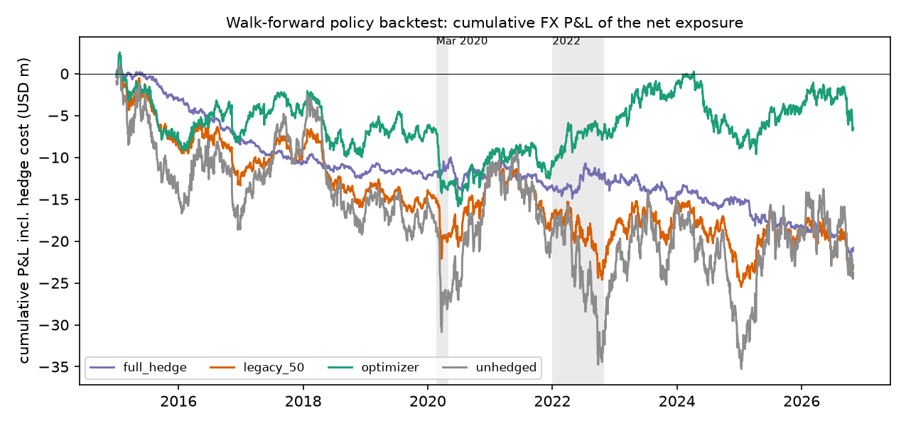
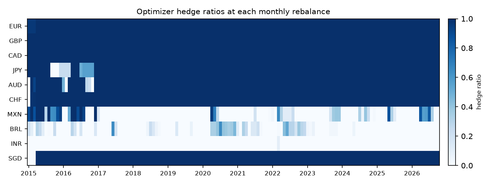
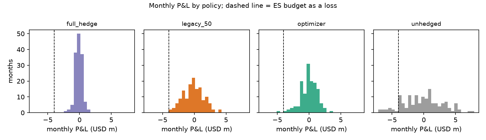

# Hedge-policy backtest

## Setup

Monthly rebalance from 2015-01-01 to 2026-10-30; ES budget USD 4.0m at 21 days / 99%; exposure input = forecast; one-month forwards priced by CIP at the origin; spreads from config/hedge.yaml charged on the notional dealt. P&L is the FX P&L of the group net exposure plus hedge mark-to-market, carry and spread; operating P&L is excluded.

## Summary by policy (USD m)

| policy | P&L vol / yr | monthly P&L vol | total P&L | carry / yr (+ = earned) | spread / yr (- = paid) | max drawdown | worst month | months losing > budget | months loss > ex-ante VaR | months | mean ex-ante ES | share of months budget binds |
|---|---|---|---|---|---|---|---|---|---|---|---|---|
| full hedge | 2.31 | 0.57 | -20.8 | -1.97 | -0.51 | -22.53 | -2.45 | 0 | 80 | 142 | 0 | 0 |
| legacy 50% | 5.29 | 1.6 | -22.89 | -1.02 | -0.26 | -26.2 | -3.8 | 0 | 4 | 142 | 4.6 | 0 |
| optimizer | 4.59 | 1.32 | -6.56 | 1 | -0.12 | -18.38 | -5.03 | 1 | 5 | 142 | 3.73 | 0.58 |
| unhedged | 9.96 | 3.06 | -23.76 | 0 | 0 | -36.26 | -7.16 | 12 | 3 | 142 | 9.1 | 0 |

Carry and spread are P&L: positive carry is earned, spread is always paid. *Months losing > budget* counts months that lost more than the ES budget: a plain loss frequency, comparable across policies, not a model test (a 99% ES is exceeded in well under 1% of months even by a correct model, and only the optimizer is held to the budget). *Months loss > ex-ante VaR* is the model test: months whose loss exceeded the policy's own ex-ante 99% VaR, about 1% of months if the model is right. A full hedge of the forecast has zero ex-ante VaR, so every losing month counts: its risk is all forecast error, which the model does not see.

## Is the optimizer's lead significant? (USD m)

| versus | months | total P&L difference | mean monthly difference | t | p | carry + spread difference | spot difference | spot p |
|---|---|---|---|---|---|---|---|---|
| full hedge | 142 | 14.2 | 0.100 | 0.95 | 0.34 | 39.8 | -25.5 | 0.08 |
| legacy 50% | 142 | 16.3 | 0.115 | 1.43 | 0.15 | 25.6 | -9.3 | 0.42 |
| unhedged | 142 | 17.2 | 0.121 | 0.77 | 0.44 | 10.5 | 6.7 | 0.77 |

Monthly P&L of the optimizer minus each other policy. t and p test that the mean difference is zero (Newey-West long-run variance). The carry and spread difference is known when the forwards are dealt; the spot difference is the result of the currency risk left open and is what decides whether the carry was worth taking.

## Optimizer hedge ratios: mean over the backtest and at the last rebalance

| ratio | EUR | GBP | CAD | JPY | AUD | CHF | MXN | BRL | INR | SGD |
|---|---|---|---|---|---|---|---|---|---|---|
| mean | 1 | 1 | 1 | 0.94 | 0.96 | 0.99 | 0.19 | 0.08 | 0 | 0.98 |
| latest | 1 | 1 | 1 | 1 | 1 | 1 | 0 | 0 | 0 | 1 |

## Stress months (USD m)

| policy | month | exposure P&L | hedge mark-to-market | carry | spread | total P&L | ex-ante VaR | ex-ante ES |
|---|---|---|---|---|---|---|---|---|
| full hedge | 2020-03 | -6.71 | 7.2 | -0.07 | -0.04 | 0.38 | 0 | 0 |
| full hedge | 2020-04 | 0.22 | 0.09 | -0.14 | -0.03 | 0.14 | 0 | 0 |
| full hedge | 2022-09 | -5.13 | 5.96 | -0.19 | -0.04 | 0.6 | 0 | 0 |
| full hedge | 2022-10 | 0.51 | -1.12 | -0.17 | -0.04 | -0.83 | 0 | 0 |
| legacy 50% | 2020-03 | -6.71 | 3.11 | -0.03 | -0.02 | -3.66 | 2.15 | 2.81 |
| legacy 50% | 2020-04 | 0.22 | 0.07 | -0.07 | -0.02 | 0.2 | 7.48 | 9.99 |
| legacy 50% | 2022-09 | -5.13 | 2.96 | -0.11 | -0.02 | -2.3 | 4.8 | 6.3 |
| legacy 50% | 2022-10 | 0.51 | -0.5 | -0.09 | -0.02 | -0.09 | 6.55 | 8.65 |
| optimizer | 2020-03 | -6.71 | 1.58 | 0.11 | -0.01 | -5.03 | 2.84 | 3.72 |
| optimizer | 2020-04 | 0.22 | -0.28 | -0.04 | -0.01 | -0.12 | 2.99 | 4 |
| optimizer | 2022-09 | -5.13 | 4.71 | 0.11 | -0.01 | -0.33 | 3.04 | 4 |
| optimizer | 2022-10 | 0.51 | -0.95 | 0.09 | -0.01 | -0.37 | 3.03 | 4 |
| unhedged | 2020-03 | -6.71 | 0 | 0 | 0 | -6.71 | 3.73 | 4.87 |
| unhedged | 2020-04 | 0.22 | 0 | 0 | 0 | 0.22 | 13.75 | 18.38 |
| unhedged | 2022-09 | -5.13 | 0 | 0 | 0 | -5.13 | 9.42 | 12.38 |
| unhedged | 2022-10 | 0.51 | 0 | 0 | 0 | 0.51 | 11.79 | 15.56 |

## By year (USD m)

| policy | year | total P&L | monthly P&L vol | worst month | carry (+ = earned) | spread (- = paid) | months losing > budget |
|---|---|---|---|---|---|---|---|
| full hedge | 2015 | -3.24 | 0.39 | -0.77 | -4.02 | -0.4 | 0 |
| full hedge | 2016 | -4.81 | 0.38 | -0.96 | -3.81 | -0.41 | 0 |
| full hedge | 2017 | -2.35 | 0.3 | -0.68 | -3 | -0.46 | 0 |
| full hedge | 2018 | -1.49 | 0.39 | -0.7 | -1.3 | -0.47 | 0 |
| full hedge | 2019 | -0.26 | 0.26 | -0.33 | -0.65 | -0.48 | 0 |
| full hedge | 2020 | 0.63 | 0.96 | -2.45 | -1.34 | -0.45 | 0 |
| full hedge | 2021 | -1.8 | 0.42 | -0.78 | -2 | -0.51 | 0 |
| full hedge | 2022 | 0.57 | 0.94 | -1.36 | -2.84 | -0.55 | 0 |
| full hedge | 2023 | -1.91 | 0.56 | -1.27 | -1.08 | -0.56 | 0 |
| full hedge | 2024 | -0.56 | 0.51 | -0.78 | -0.52 | -0.6 | 0 |
| full hedge | 2025 | -3.12 | 0.6 | -1.79 | -1.03 | -0.63 | 0 |
| full hedge | 2026 | -2.45 | 0.69 | -1.7 | -1.65 | -0.57 | 0 |
| legacy 50% | 2015 | -8.68 | 1.01 | -1.98 | -2.05 | -0.2 | 0 |
| legacy 50% | 2016 | -3.55 | 1.47 | -2.89 | -1.94 | -0.21 | 0 |
| legacy 50% | 2017 | 3.19 | 0.94 | -1.63 | -1.55 | -0.23 | 0 |
| legacy 50% | 2018 | -5.46 | 1.33 | -2.31 | -0.7 | -0.24 | 0 |
| legacy 50% | 2019 | 0.61 | 1.25 | -1.83 | -0.37 | -0.24 | 0 |
| legacy 50% | 2020 | 2.2 | 2.2 | -3.66 | -0.7 | -0.23 | 0 |
| legacy 50% | 2021 | -4.98 | 1.29 | -2.32 | -0.99 | -0.25 | 0 |
| legacy 50% | 2022 | -2.01 | 2.21 | -3.8 | -1.45 | -0.27 | 0 |
| legacy 50% | 2023 | 3.5 | 1.84 | -2.53 | -0.61 | -0.29 | 0 |
| legacy 50% | 2024 | -9.57 | 1.45 | -3.04 | -0.3 | -0.3 | 0 |
| legacy 50% | 2025 | 5.79 | 1.88 | -3.48 | -0.57 | -0.32 | 0 |
| legacy 50% | 2026 | -3.93 | 1.94 | -3.03 | -0.85 | -0.29 | 0 |
| optimizer | 2015 | -7.83 | 0.95 | -2.01 | -0.6 | -0.11 | 0 |
| optimizer | 2016 | 0.78 | 1.54 | -3.67 | -0.2 | -0.09 | 0 |
| optimizer | 2017 | 2.67 | 0.89 | -1.26 | 0.53 | -0.09 | 0 |
| optimizer | 2018 | -3.59 | 1.47 | -2.51 | 1.25 | -0.09 | 0 |
| optimizer | 2019 | 1.8 | 1.41 | -3.18 | 1.66 | -0.09 | 0 |
| optimizer | 2020 | -3.21 | 2.14 | -5.03 | 0.31 | -0.14 | 1 |
| optimizer | 2021 | -1.03 | 1.05 | -1.9 | 0.28 | -0.12 | 0 |
| optimizer | 2022 | 3.58 | 1.41 | -2.21 | 0.46 | -0.16 | 0 |
| optimizer | 2023 | 5.57 | 1.14 | -1.37 | 1.97 | -0.12 | 0 |
| optimizer | 2024 | -7.69 | 1.06 | -2.65 | 2.13 | -0.12 | 0 |
| optimizer | 2025 | 4.76 | 0.89 | -1.3 | 2.52 | -0.14 | 0 |
| optimizer | 2026 | -2.38 | 1.38 | -3.11 | 1.54 | -0.14 | 0 |
| unhedged | 2015 | -14.22 | 2.01 | -3.64 | 0 | 0 | 0 |
| unhedged | 2016 | -2.67 | 2.78 | -5.01 | 0 | 0 | 1 |
| unhedged | 2017 | 9.11 | 1.7 | -2.69 | 0 | 0 | 0 |
| unhedged | 2018 | -8.86 | 2.59 | -4.05 | 0 | 0 | 1 |
| unhedged | 2019 | 1.76 | 2.47 | -3.87 | 0 | 0 | 0 |
| unhedged | 2020 | 4.11 | 3.96 | -6.71 | 0 | 0 | 1 |
| unhedged | 2021 | -7.69 | 2.31 | -3.89 | 0 | 0 | 0 |
| unhedged | 2022 | -5.24 | 4.06 | -7.16 | 0 | 0 | 3 |
| unhedged | 2023 | 8.57 | 3.6 | -3.9 | 0 | 0 | 0 |
| unhedged | 2024 | -18.54 | 2.92 | -6.37 | 0 | 0 | 2 |
| unhedged | 2025 | 14.45 | 3.62 | -6.28 | 0 | 0 | 1 |
| unhedged | 2026 | -4.55 | 3.89 | -5.67 | 0 | 0 | 3 |

## Figures

